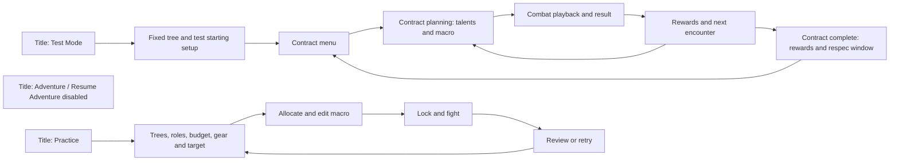

# M4-T2 — UI/UX and player-feedback specification

Date: 2026-09-25. Status: **Complete — specification and initial inventory; implementation and rendered acceptance remain downstream.**

This is a design deliverable. It does not promote content, implement screens,
approve new mechanics, or claim rendered Godot acceptance. The decision table
distinguishes explicit user choices from implementation defaults selected in this
specification. Rendered testing may refine sizes/layout without changing mechanics.

## Authority and scope

- [M4 tracker](P6M4_Playable_Integration_And_UI_Validation_Tracker.md): task ownership.
- [Build rules](P6M2_T3_Progression_And_Allocation_Rules.md): budgets, roles, allocation and respec.
- [Combat rules](Combat_Mechanics_Reference.md): authoritative mechanics and timing.
- [Core fixture](P6M3_T8_Core_Bladedancer_Validation_And_M4_Handoff.md) and
  [mixed fixture](P6M3_T10_Gold_And_Mixed_Build_Handoff.md): exact playable candidates.
- [Identity manifest](P6M2_T4_Content_Identity_Manifest.json): stable tree-content IDs.

Core: Bladedancer 10, Whetstone 4 / Rending Slash 1 / Fancy Footwork 5.
Seven skills: Hold, Stab, Heavy Slash, Quick Cut, Leaping Plunge, Parry Strike,
Rending Slash. Example rotation: Quick Cut / Quick Cut / Parry Strike /
Leaping Plunge / Rending Slash.

Mixed: Bladedancer 15 adds Opportunity 3 / Cloak & Dagger 2; Thief 5 has
Keen Eye 5. Adds Dance of Death, Steal and Mug, for ten unlocked skills.
Example rotation: Dance / Quick Cut / Quick Cut / Parry Strike / Leaping Plunge /
Rending Slash / Steal / Mug. Practice also checks reversed roles with ranks intact.
These are acceptance builds, not automatically forced player allocations.

Gilded Blade, Silvered Edge, Big Score and other mature content are not part of
that exact build. Their presentation may be exercised with explicitly labelled
synthetic UI data without making them selectable gameplay content.

## 1. Existing-screen audit

Audit method: inspected current scene scripts, resources, palette, viewport
configuration and representative existing icon images. Findings below are source
observations and layout risks; no live-screen inspection was performed in T2.

| Surface / source | Existing behavior worth retaining | Required change or validation |
| --- | --- | --- |
| `scenes/title/title.gd`, `scenes/game_root.gd` | Hidden `contract_test_pressed` signal is still connected to a direct contract-entry handler. | Restore visible Test Mode; disable new/resume Adventure. Replace old Assassin/Bladedancer, seven-point setup and destructive Adventure-save reuse. |
| `scenes/subclass_select/subclass_select.gd` | Four illustrated single-choice cards; existing entry flow. | Retain for future Adventure restoration; explain roles in Practice and the fixed Test Mode summary. No primary-selection screen before the requested direct Test Mode entry. |
| `scenes/combat/talent_panel.gd` | Shared Adventure/Practice state interface; primary/secondary columns; rank transactions and error feedback. | Ranked path is a flat list with +/−, current stat modifiers and full refund. Add rank-aware layout, next-rank effects, prerequisite/gate explanation and automatic-unlock track. |
| `scenes/combat/talent_overlay.gd` | Scrollable, dismissible modal. | Two 400-unit tree columns inside an 860-unit scroll area leave little room for details. Specify bounded tree canvas and details pane; do not simply widen every node. |
| `scenes/combat/available_skills_panel.gd` | Click to append; disabled while locked/full; icons and tooltip hook. | One horizontal container risks overflow with seven/ten skills. Use a wrapping or scrollable list and persistent skill details. |
| `scenes/combat/skill_build_panel.gd` | Ten-slot limit, order badges, click removal, lock, cast progress, stun and interruption feedback. | Add deliberate selection/removal and reorder controls; distinguish conditional readiness, cooldown, manual lock and combat lock. |
| `scripts/ui/skill_tooltip_formatter.gd` | Shared Adventure/Practice formatter and resolved-stat access. | Current branches cover inherited effects and coarse speed labels; do not adequately describe reviewed conditional skills, buffs, shared cooldowns or Mug. |
| `scripts/ui/combat_playback_presenter.gd` | Shared playback clock, stage, enemy Poison/Shred/Decay and interruption presentation. | Add consumption of M3 lifecycle/scheduling/gold state; source search found no existing Footwork/Readiness/Dance event presentation. |
| `scenes/training_room/training_room.gd` | Three-column Adventure-like arrangement, target/seed/gold controls, independent persistence and save notices. | Reuse final build components; make role reversal, reset behavior and invalidated results clear. Preserve test isolation. |
| `scripts/ui/playback_controls.gd` | 1x/2x/4x and persistent Skip modes. | Keep semantics; current small labels/buttons need size checks. No pause/scrub requirement is introduced by this draft. |
| `scripts/ui/ui_colors.gd`, `project.godot` | Earth & Iron palette; 1600×900 base, canvas-item stretching, kept aspect. | Preserve user-selected existing style. Validate physical readability at smaller windows instead of assuming the base viewport guarantees it. |

Paths in this table are relative to `project/`. Existing broad working-tree changes
were present before T2; this task changes documentation/inventory only.

## 2. Player journeys and content availability



**User decision, 2026-09-25:** temporarily disable Adventure and restore a visible
button named **Test Mode**, opening the contract menu directly with a fixed tree.
Test Mode is the proxy for the Adventure flow during this integration milestone.
Practice Room remains available. Detailed icon art decisions move to Icon Lab;
current icons/style are the interim reference.

Title shows grayed-out New Adventure and Resume Adventure controls with a
readable explanation, “Adventure is temporarily unavailable during the Phase 6
test.” Disable their handlers as well as their visual controls. Existing saved
Adventure progress is preserved; disabling the mode does not authorize deletion.
Test Mode skips class/tree selection and the Tavern and prominently labels its
fixed starting build on the contract menu. Keep the seed controls applicable to
the test run; do not start a fight immediately or bypass contract choice.

**User-selected starting setup Q6:** Rogue with Bladedancer fixed as primary,
no secondary in the initial core slice, ten earned/unspent points, zero purchased
ranks and an empty unlocked macro. Go directly to the contract menu. The player
allocates and arranges skills through the normal UI; the exact core allocation
and sample macro above are the acceptance procedure, not an automatic loadout.
“Fixed tree” fixes its identity; normal legal rank editing remains available.
Fight is unavailable until the macro is nonempty and explicitly locked. T9 adds
the exact mixed fixture; until then, unsupported secondary choices must not enter
a build. T4 specifies that content boundary.

Preserve contract-completion +5 and the 45-point earned-budget cap. Unspent points
remain legal even if all currently supported ranks are filled. Unsupported nodes
are inspectable and labelled “Not available in this test,” rather than pretending
that earning more points will unlock them. Do not silently buy unsupported ranks,
invent unlocks or mix redesigned and compatibility mechanics. If a later contract
cannot be offered safely within the integrated content, T4 must state that boundary
explicitly; no new progression cap is approved here. The original zero-point
Adventure start, Tavern 1/0/4/5 and secondary milestone remain preserved rules for
the eventual restored Adventure, not part of Test Mode's skipped entry sequence.

**User-selected persistence Q7:** fresh Test Mode session on every entry; no Test
Mode save/resume. Preserve Adventure and Practice saves. Leaving for Title/Exit
discards the in-memory test run; show “Test Mode progress is not saved” at entry
and provide an exit confirmation when leaving an active test session. Between
fights/contracts within the session, retain earned points, gear, gold and results
normally. Practice remains independently persistent.

Never call the old handler unchanged: it deletes the Adventure save, selects legacy
Assassin/Bladedancer directly, gives seven points/100 gold/Bandit Blade, and starts
the generated-contract offer. Reuse its entry routing only after T4 replaces that
setup with the selected content revision and save isolation. Disable or relabel
inherited “Save and Quit” and autosave behavior for Test Mode; merely changing the
entry handler would still allow combat/reward/exit paths to overwrite Adventure.
All Test Mode callbacks, retries, restart and shutdown paths must honor the
nonpersistent mode. Initial gear, gold,
contract level/difficulty and secondary availability are fixture parameters T4
must publish; inherited hidden-handler values are not implicitly approved.

Practice exposes only verified playable content for fighting; the all-tree icon
catalog is separate. Practice keeps editable 0–45 budget and independent state.
If a budget/tree edit would invalidate ranks, explain the consequences through
the state model; do not silently discard a build. Role reversal should be one
explicit action preserving per-tree ranks and surviving rotation order. Ordinary
Adventure respec retains both identities and roles.

## 3. Tree selection and allocation

User-selected layout: tiered icon nodes grouped by authored point gate,
with actual prerequisite connectors. Row position is not an extra prerequisite.
Show the selected primary/secondary tree tabs and both invested totals even when
only one tree canvas fits. At wider sizes, two trees may appear side by side only
if readable; one-tree tab view is the dependable minimum-size arrangement.

```text
Talent Trees          Earned 20 / Spent 20 / Unspent 0                 Close
Primary: Bladedancer 15   |   Secondary: Thief 5
Intrinsic: base +5% retrigger +3% primary investment = 8%
Automatic skills: [1 Quick Cut ✓] [3 Plunge ✓] [6 Parry ✓] [12 Dance ✓]
┌── scrollable tree canvas ─────────────────┬── selected talent ────────┐
│ Gate 0    icon + name + rank/max          │ Name / rank / source      │
│ Gate 5    nodes and true prerequisites    │ Current effect            │
│ Gate 10   nodes                          │ Next rank and difference  │
│ Gate 15   nodes                          │ Requirements / restriction│
│ Gate 20   nodes                          │ [− Refund] [+ Allocate]   │
└──────────────────────────────────────────┴───────────────────────────┘
Refund all ranks          Feedback: exact rejected edit or unlock change
```

This is a structural wireframe, not an approved pixel layout. Omit empty automatic
slots from the compact strip; detail view may say “9 points: no skill.” Never
invent a reward for the intentionally empty Bladedancer/Thief nine-point slots.

Interaction requirements:

- Clicking a node selects details; explicit +/− controls change one rank. Keyboard
  activation offers the same actions. Do not rely on undisclosed right-click.
- Show name, icon, numeric rank/max and selected/available/locked/unavailable
  state. Color supplements labels and symbols. Read-only locked nodes remain
  inspectable through focus/details.
- Details show current effect, next-rank effect (or Maximum rank), tree investment
  requirement, named prerequisites and unlocks. Do not use “No effect” when a
  rank has non-stat behavior; author that behavior from the accepted contract.
- A gate reads “Requires 5 points in Bladedancer; currently 4.” One existing rank
  satisfies a prerequisite. Points in the other tree never satisfy the gate.
- Legal edits resolve once, refresh totals/intrinsics/unlocks, clear the build
  lock, and persist under the established mode policy. Keep selected node,
  scroll position and keyboard focus through refresh.
- Rejected edits change nothing and show a nearby reason. A blocked refund names
  dependent talents or the resulting gate failure. Never cascade-refund.
- Adventure purchases use the planning flow; refunds are free only between
  contracts, never during a contract/retry/playback. Practice edits are free
  outside playback. Show that restriction directly at refund controls.
- “Refund all ranks” applies to both trees and keeps roles. Show its scope and
  potential rotation losses before activation; use a confirmation for this broad
  edit. Single-rank edits need no confirmation.
- Unlock notifications identify newly available skills without inserting them.
  Lost skills remove only unavailable rotation entries; preserve survivor order
  and duplicates and visibly list removals. Reunlocking does not restore slots.

Selection cards explain base intrinsic and primary-only scaling independently.
Example: Bladedancer primary 10 = 5% base +2 percentage points = 7% retrigger.
Mixed role reversal changes 8% retrigger/+10% gold to 5%/+20%, at the same ranks.
Describe +percentage points correctly; do not show multiplicative +21% gold.

## 4. Skills, tooltips and rotation editing

Available Skills becomes a bounded wrapping list; show icon, name, category and
unlock source in details. Default list shows unlocked skills. An optional locked
view must distinguish point-locked from unavailable preview content.

Selecting a skill opens persistent details with an explicit Add action; a compact
Add button may preserve fast append. Details remain accessible when the macro is
full or editing is locked. Ten slots maximum; duplicate skills are intentional.

Rotation slots show icon, short name, order and contextual status. Click selects;
Remove and Move earlier/later actions are explicit. Drag reordering may supplement
these buttons but cannot be the only method. At constrained widths wrap as two
numbered rows rather than shrinking ten slots until unreadable. Preserve left-to-
right, then top-to-bottom order. No automatic rotation optimization.

Lock is an explicit macro-ready state; fight requires a nonempty locked macro.
During playback all edits are locked and explain why. Differentiate this from a
skill cooling down or lacking Readiness. A selected skill can still be inspected.

Tooltip/details order:

1. Name, icon, category and unlock source.
2. What it does, including conditions and resources spent.
3. Base/minimum cast time, current estimate and relevant modifiers.
4. Cooldown and shared-duplicate rule where applicable.
5. Current-build scaling and conditional/dynamic bonuses, labelled as estimates.

Examples of required copy (values come from the combat reference):

- **Parry Strike:** “Requires and consumes 1 Readiness at cast start. Without
  Readiness, spends its cast time without effects.” It is not a zero-time skip.
- **Leaping Plunge:** “Consumes all Footwork at cast start to shorten this cast.”
  Show current stack count and estimated time; do not imply later buffs change
  an already accepted cast. No Riposte damage bonus in the core build.
- **Dance of Death:** “After the 0.5s activation, grants a 5s window for guaranteed
  eligible macro repeats. 20s cooldown begins at cast start and is shared by all
  copies.” Explain that a cooling slot spends 0.1s and advances without effects.
- **Mug:** “Adds gold stolen this fight to base physical damage, up to +100.”
  Show stolen/countable values separately from starting/current stash.

Avoid unconditional damage promises: defense, crit, live temporary stats and
cast-start snapshots can change the actual outcome. Hover provides a compact
summary; click/focus details provides long, scrollable descriptions without
covering the required action. Same formatter contract in Adventure and Practice.

## 5. Combat playback and effect presentation

Retain the main combat stage, enemy defenses/statuses, macro strip and playback
controls. Place **Player effects** near the macro/stage, separate from **Enemy
statuses**. Keep cast progress, fight timer and essential actions visible.

| Effect / state | Always-visible information when active | Details / lifecycle |
| --- | --- | --- |
| Footwork | Icon, name, stacks `3/5`, remaining duration | Shared 3s timer; refresh/grant and actual consumption from events. Show spent stacks on Plunge start. |
| Readiness | Icon, name, `1 charge` | Untimed; no fake countdown. Parry spends at accepted start. |
| Dance | Icon, name, remaining buff duration | Separate from 20s skill cooldown; duration starts on activation completion. |
| Skill cooldown | Remaining seconds on all matching macro copies | One deadline per stable skill ID. A cooling attempt is marked `Cooldown — 0.1s`, without a hit animation. |
| Missing Readiness | Parry slot reason and spent-time progress | No damage/grant animation; normal scheduled cast time is still spent. |
| Poison / Shred / Decay | Existing enemy-side icons and actual stack counts | Distinguish natural/forced fuel depletion from keyword Consume in details/log. |
| Theft / Mug | Current stash and `Stolen this fight`; Mug bonus `counted/100` | Raw and credited theft in log; no second multiplier during playback. |
| Interrupt / stun / slow | Existing visual state plus readable label | Must remain distinguishable from cooldown, missing charge and manual lock. |

Overflow proposal: stable semantic order, two compact rows at most, then a
`+N effects` button opening a scrollable inspector. Reserve visible positions for
Footwork/Readiness/Dance when active, then other buffs; enemy statuses stay in
their own region. Do not resort chips every timer tick. The inspector lists all
active instances with source, amount and expiry; it remains within the viewport.
Do not stack multiple independent expiry times into one misleading timer: use
instance count plus nearest expiry in summary, full instance rows in details.

Counts reflect the event state immediately. Cosmetic grant/consume/expiry cues
must not keep an expired buff logically active. At 4x, coalesce visual flourishes
as needed but retain state changes and review evidence. Skip applies final state
once, credits gold once and clears temporary state; do not simulate fake timers
after the result. Practice retry restores configured starting stash, clears theft,
cooldowns and effects; Adventure retains credited stash under existing rules.

Playback uses simulation timestamps and ordered events, never wall-clock buff
logic or a parallel combat calculator. Preserve tied-event sequence and the
Footwork exact-deadline exception. Cast duration is captured at start; damage can
use live stats at impact. Surface macro/retrigger/proc origins distinctly in the
log and short cues, without moving the macro pointer for each child trigger.

**Implementation dependency:** diagnostic trace recording is optional today.
T7 must provide the necessary ordered presentation data in normal playable
results (or an equivalent immutable projection), not make correctness depend on
an optional debug switch. Reuse existing results/events, verify trace-on/off
parity, and keep UI read-only. This is presentation plumbing, not a resolver rewrite.

Inherited T8 example for acceptance: seed seven has three Footwork and Readiness
after the Quick Cut sequence at 1700ms; Parry consumes Readiness at 1700ms;
Plunge consumes three Footwork at 2200ms and finishes at 3950ms. Compare against
the exact fixture trace; gear/seed differences do not use these timestamps.

## 6. Art conventions and initial icon inventory

See [machine-readable inventory](P6M4_T2_Icon_Inventory.json). It contains all
44 talent and 20 skill identities from the manifest, plus three base Rogue skills
from existing resources: **67 entities**. Tree/intrinsic/automatic-slot records
are not duplicate skill/talent identities. All 67 IDs are distinct.

There are ten existing skill-resource icon references and 57 unassigned entities
(44 talents and 13 skills). Asset existence is not approval of its visual meaning.
No dedicated talent icon directory or `Talent.icon` property was found; `Skill`
already exports an icon. T3 defines the mapping lookup/resource application
contract before T5 consumes talent assignments.

| Scope | Entity coverage | Existing candidates | Gaps |
| --- | --- | --- | --- |
| Core | 3 talents + 7 skills | Hold, Stab, Heavy Slash, Quick Cut, Rending Slash | All 3 talents; Leaping Plunge; Parry Strike |
| Mixed additions | 3 talents + 3 skills | Steal | Opportunity, Cloak & Dagger, Keen Eye; Dance; Mug |
| Other library | 38 talents + 13 skills | Venom Jab, Poison Strike, Beguiling Strike, Death Strike | Remaining 47 entities need assignments |

Existing skill art: `project/assets/skill_icons/rogue/` (10 PNGs).
Nine are 32×32; Hold is 512×512. Its downsampled readability must be checked at
the same actual display sizes; do not assume all source assets share a pixel grid.
Subclass art: `project/assets/subclass_icons/rogue/` (4 PNGs).
Combat art: `project/assets/combat_ui_icons/` (7 PNGs: health, armor,
resistance, Poison, Shred, Decay, damage sword). Existing mechanic icons under
`project/assets/ui/icons/mechanics/` are additional reuse candidates.

Core feedback also needs Footwork and Readiness symbols; mixed adds Dance
feedback. These are outside the 67 skill/talent records. Mature synthetic cases
may use clearly marked placeholders for Precision, Bypass, Touch, Virulent,
Master, Beguiling and defense debuffs. Their production is not an M4 content gate.

User-selected interim direction: retain current icons/style, compact pixel-art silhouettes and the
Earth & Iron interface palette. Existing Quick Cut and Bladedancer images were
inspected as examples, not as a full art acceptance pass. Preserve aspect ratio;
avoid tiny lettering baked into art. Borders, ranks, timers and lock symbols are
UI overlays. PNG with transparency is the baseline exchange format; keep source
masters separate and retain provenance/license metadata for any added assets.
T3 chooses detailed art direction/production workflow, library packaging, mapping
version and application method. T2's sizes and coverage guide that work without
prematurely approving new art or a new asset pack.

Preview sizes: existing skills use 28px list icons and 58px art in 72px macro
slots; subclass headers use 54px; status icons use 22px. Include those actual
contexts in Icon Lab, plus proposed 32px talent/effect icons and a 64px inspection
preview. Check on panel, deep-panel, selected and disabled backgrounds, with
rank/count/timer overlays. Final sizes remain adjustable after rendered checks.

Intentional reuse is allowed if meaning stays clear: Rending Slash talent may
share its granted skill's image, with a talent/rank frame. A skill and the buff
it grants may share art with different labels. Unrelated talents should not
silently share a generic weapon symbol. Unassigned entries use an explicit
neutral placeholder plus name; missing assets show validation errors in Icon Lab.

Do not use filenames/display names as mapping identity: Rending Slash is
`skill.rending_thrust`, Beguiling Strike is `skill.toxic_flurry`, Death Strike is
`skill.killers_mark`. Base skills are explicit catalog additions to the tree
manifest; no source-manifest mutation is needed for this inventory.

## 7. Display, accessibility and demanding cases

User-selected desktop targets: 1280×720 minimum, 1600×900 reference and
1920×1080. Mouse and keyboard are required; full controller/mobile work is outside
this pass. Improve the existing style/layouts rather than replacing the visual theme.

At reference size: retain Adventure/Practice's three-region organization; bounded
side panels scroll independently and center-stage height remains usable. If
physical text/control size fails at minimum resolution, reflow/collapse secondary
panels and use tree tabs instead of shrinking everything. Inspect actual output
pixels as well as logical viewport size under canvas stretching/OS scaling.

Proposed readability targets: primary body text at least 16 physical pixels,
secondary labels at least 14; key actions at least 32px high. Use a 125% text-size
stress case to expose clipping; T2 does not claim a text-scale setting exists.
Maintain focus visibility, logical tab order, keyboard Add/Remove/Move controls,
Escape/Close and focus restoration for modals. Long descriptions must be
inspectable without hover. Never encode role, availability or effect type by
color alone. Suppress optional pulses/flashes in a reduced-motion presentation
mode; T7/T10 establish the exact setting integration and verify static cues.

| Case | Fixture and required result | Downstream owner |
| --- | --- | --- |
| U01 | Test Mode goes directly to contract choice with its fixed setup; Adventure new/resume remain disabled. Practice checks zero points through core 10: role, shared budget, 5-point gate and three talent ranks. | T4/T5/T8 |
| U02 | Invalid purchase/refund and active-contract refund: exact reason, no state mutation, focus preserved. | T5/T8 |
| U03 | Automatic unlock gain/loss: empty nine-point slot grants nothing; removed macro entries named. | T5/T6/T8 |
| U04 | Seven core/ten mixed unlocked skills and ten macro slots: no clipped actions; duplicates and reordering work. | T6/T8/T9 |
| U05 | Long conditional tooltip at every screen edge: scroll/pin details remain readable and accessible. | T6/T10 |
| U06 | Exact core event sequence, unavailable Parry, Footwork expiry boundary: displayed state reconciles. | T7/T8 |
| U07 | Duplicate Dance slots: shared cooldown, separate buff timer, 100ms failed attempt visible. | T7/T9 |
| U08 | Theft, Mug 0/below/at/above 100 and Practice retry: stash/theft/capped bonus never conflated. | T7/T9 |
| U09 | Role reversal of exact mixed allocation: correct 8→5% retrigger and 10→20% gold; ranks retained. | T9 |
| U10 | Dense full-library trees and longest names, using labelled synthetic UI data: all nodes/details reachable. | T5/T10 |
| U11 | Twelve synthetic active effects, independent instances, enemy statuses, stun and cooldown: overflow inspector exposes every entry. | T7/T10 |
| U12 | Synthetic Gilded at 499/500/501 stash and Silvered below/at/above cap: source contribution distinct from total. No playable promotion. | T7/T10 |
| U13 | 1x/2x/4x/Skip, finish and retry: timers use simulation time; no stale effects or double gold. | T7/T8/T9 |
| U14 | Reenter Test Mode: ten unspent points, fixed Bladedancer, empty macro and fresh fixture state. Exercise rewards, retry, Title, Exit and inherited autosave/save-and-quit paths; Adventure/Practice saves unchanged. Practice still saves/loads independently. | T4/T8/T9 |
| U15 | All target sizes, 125% text stress, keyboard-only edit, reduced motion, modal focus: essential actions remain usable. | T10 |
| U16 | Representative Icon Lab assignment round trip appears in actual talent/skill screens; missing/unknown mappings detected. | T3/T5/T6/T10 |

Each rendered check records content revision, build/ranks/roles, gear, target,
seed, display/window/UI scale, steps, expected/actual result and screenshot path.
Automated checks validate transactions and event agreement; rendered checks
validate layout and comprehension. Record deviations with owner and disposition.
T2 defines these checks; T8/T10 execute them after implementation.

## 8. Decisions for user review and closeout

| Question | Recommended draft | Status |
| --- | --- | --- |
| Q1 Visual scope | Improve existing style/layouts; retain mode family resemblance. | User selected |
| Q2 Displays/input | Desktop mouse/keyboard; 1280×720, 1600×900, 1920×1080. | User selected |
| Q3 Icon direction | Current icons/styles now; detailed art decisions in Icon Lab. | User selected |
| Q4 Talent layout | Tiered icons/ranks with prerequisite links. | User selected |
| Q5 Adventure boundary | Disable Adventure; restore Test Mode going directly to contracts with a fixed tree. Supersedes the proposed limited-Adventure-preview option. | User specified |
| Q6 Test starting setup | Fixed Bladedancer; ten unspent points and an empty rotation. Supersedes proposed preallocation. | User selected |
| Q7 Test persistence | Fresh session each entry; no test save/resume; preserve Adventure and Practice saves. Supersedes proposed separate persistent save. | User selected |

Routine interaction proposals (selection/details, explicit rank actions,
reordering buttons, overflow inspector, immediate state feedback) are documented
above for review. They introduce no gameplay-rule changes.

T2 closeout checklist:

- [x] Existing screen/data/presentation paths audited from source.
- [x] Proposed selection/allocation/rotation/combat/Practice flows documented.
- [x] Asset coverage inventory prepared with stable identities and scope labels.
- [x] Display/accessibility and demanding-case acceptance matrix drafted.
- [x] Resolve user choices Q1–Q5 and reconcile affected sections.
- [x] Resolve Test Mode setup/persistence Q6–Q7.
- [x] Reconcile the specification with the user's answers and record those choices in the M4 tracker.
- [x] Close T2 as specification work and hand off T3; leave implementation/visual acceptance outstanding.

Validation: parsed the inventory; checked unique IDs, all 64 manifest skill/talent
records plus three base skills, exact core/mixed membership, asset existence and
PNG dimensions. Checked documentation links and status consistency. No runtime
tests were needed for this documentation/inventory-only change; source and static
checks do not establish visual usability.

No new mechanic is accepted here, so the combat rules reference needs no change.
